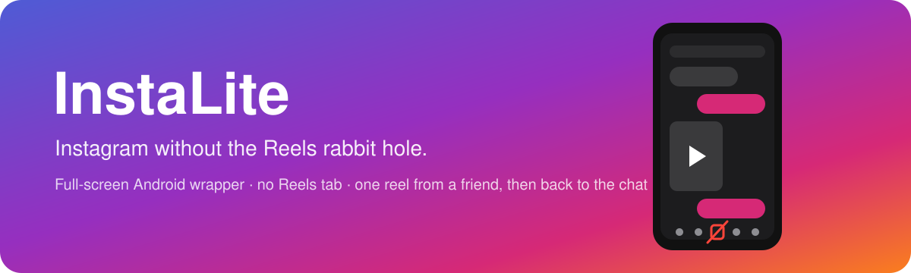
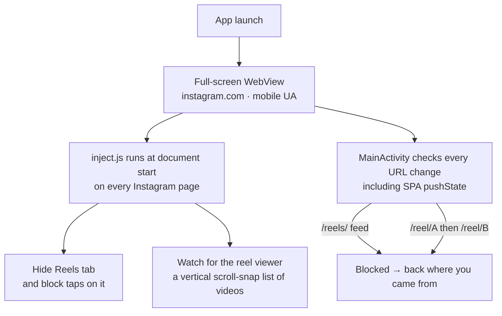
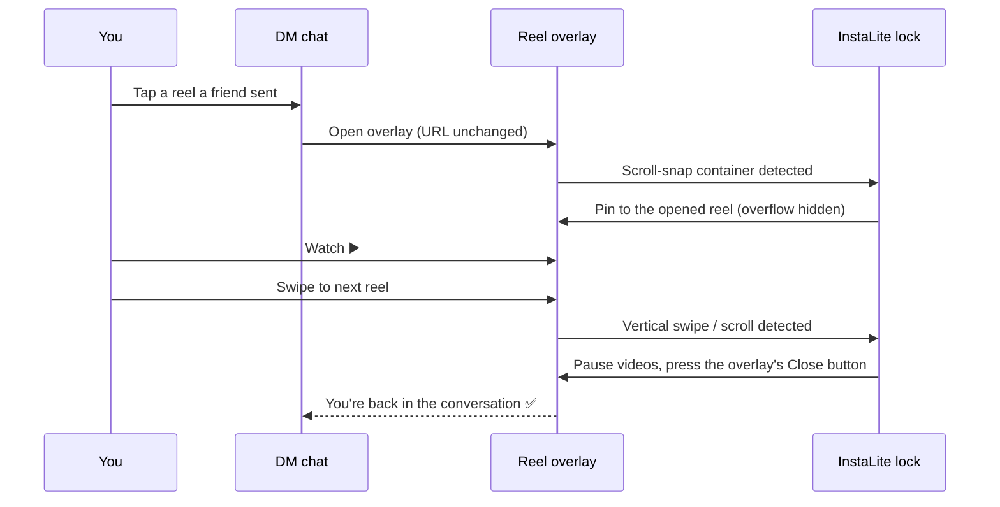

<p align="center">
  
</p>

<p align="center">
  
  
  
  
  
</p>

---


**InstaLite** is a tiny Android app that runs the Instagram mobile website full screen, with one goal: **keep the useful parts (feed, DMs, stories, profiles) and cut off the endless Reels scroll.**

- 🚫 The **Reels tab is gone** from the bottom bar, and the Reels feed can't be opened at all.
- 💬 Reels your **friends send you in DMs still play**.
- ↩️ Try to **swipe to the next reel** and you're sent straight **back to the chat**.

## 🧩 Two versions

The project builds **two apps from the same code** (Gradle product flavors). Both can be installed side by side.

| Version | Flavor | App name | Package | What you get |
|---|---|---|---|---|
| 📸 **Full** | `full` | InstaLite | `com.mohammad.instalite` | Feed, DMs, stories, profiles, with no Reels feed (everything described below) |
| 💬 **Messages only** | `dms` | InstaLite DMs | `com.mohammad.instalite.dms` | **Only Instagram DMs.** Opens on the inbox, and every other page is blocked |

### 💬 Messages-only version (`dms`)

- 📥 Opens straight on the **DM inbox** (`/direct/inbox/`).
- 🚫 **Feed, Explore, Reels, profiles, notifications and search are blocked.** Any navigation outside `/direct/` sends you back to the inbox.
- 🙈 Nav links that leave the DMs (home, explore, reels, create, profile) are **hidden** by `dms.js`.
- 🧹 **Cleaner inbox:** the Notes tray (note bubbles above "Messages"), the useless Back arrow, the username/account switcher and the New message icon are hidden from the inbox header, so the **search bar is the first thing you see** (it stays in the same spot). Inside a chat, Back still returns to the inbox.
- 🔑 Login, 2FA and security-check pages (`/accounts/`, `/challenge/`, `/two_factor`) still work so you can sign in.
- 🎬 Posts, reels and stories **friends send you in a chat still open** (`/p/`, `/reel/`, `/stories/`). The single-reel lock from the full version still applies.

Everything else (full screen, stays logged in, uploads, external links) works the same in both versions.

## ✨ Features

| | Feature | How |
|---|---|---|
| 📱 | **Full screen, mobile layout** | Immersive mode hides status and navigation bars; a WebView loads `instagram.com` with a plain mobile Chrome user agent |
| 🚫 | **No Reels tab** | CSS + DOM script hides the nav item; taps on it are swallowed |
| 🔒 | **Reels feed blocked** | Any navigation to `/reels/` is intercepted natively and sent back |
| 🎬 | **One reel at a time** | A shared reel plays normally; its scroller is locked to that reel |
| ↩️ | **Swipe = back to chat** | Swiping up/down in the viewer closes it and returns you to the conversation |
| 🍪 | **Stays logged in** | Cookies and local storage persist between launches |
| 🖼️ | **Uploads work** | File chooser wired up for sending photos/videos |
| 🌐 | **External links** | Non-Instagram links open in your normal browser |

## 🧭 How it works



### The DM reel lock

When you tap a reel inside a chat, Instagram doesn't change the URL. It opens an overlay that holds a vertical **scroll-snap list of reels**, with the next ones already loaded. InstaLite finds that list and locks it:



If the Close button can't be found, InstaLite reloads the chat as a fallback. Either way, you never reach the second reel.

## 📂 Project structure

```
instalite/
├── app/
│   ├── build.gradle.kts           # full + dms product flavors
│   └── src/main/
│       ├── AndroidManifest.xml
│       ├── assets/
│       │   ├── inject.js          # Hides Reels tab, locks the DM reel viewer (both versions)
│       │   └── dms.js             # Messages-only version: hides nav links that leave the DMs
│       ├── java/com/mohammad/instalite/
│       │   └── MainActivity.kt    # WebView, full screen, URL rules, uploads, DMs-only rule
│       └── res/                   # theme + adaptive app icon (vector)
├── docs/                      # README banner + icon preview
├── build.gradle.kts
└── settings.gradle.kts
```

## 📥 Download

Grab the latest APK from the [**Releases page**](https://github.com/MohammadAlsheroa/instalite/releases/latest) (current version **1.0.0**).

| Version | APK |
|---|---|
| 📸 Full | [`InstaLite-1.0.0.apk`](https://github.com/MohammadAlsheroa/instalite/releases/download/v1.0.0/InstaLite-1.0.0.apk) |
| 💬 Messages only | [`InstaLite-DMs-1.0.0.apk`](https://github.com/MohammadAlsheroa/instalite/releases/download/v1.0.0/InstaLite-DMs-1.0.0.apk) |

Open the APK on your phone and allow installs from your browser or file manager when Android asks. Both versions can be installed side by side.

## ⚠️ Disclaimer

InstaLite is an unofficial, personal-use project. It isn't affiliated with, endorsed by, or connected to Instagram or Meta. It simply displays the public Instagram website inside an Android WebView. "Instagram" is a trademark of its owner.
